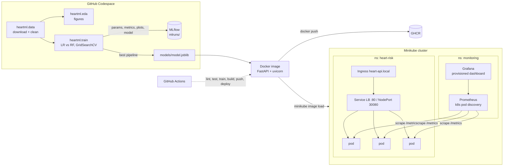

# Heart Disease Risk - End-to-End MLOps

Predicts the presence of heart disease from 13 clinical attributes (UCI Heart Disease, Cleveland subset)
and serves the model as a monitored, containerised API on Kubernetes.

**Stack:** scikit-learn · MLflow · joblib · FastAPI · Docker · GHCR · Minikube/kubectl · GitHub Actions · Prometheus · Grafana

> Step-by-step build and commit guide for GitHub Codespaces: **[RUNBOOK.md](RUNBOOK.md)**

## Architecture



## Repository layout

| Path | What it is |
|---|---|
| `heartml/` | Python package: `config`, `data` (download/clean), `eda`, `features` (ColumnTransformer), `train` (MLflow), `predict` |
| `api/main.py` | FastAPI: `/predict`, `/predict/batch`, `/health`, `/model`, `/metrics` (Prometheus), `/metrics/summary` |
| `tests/` | pytest suite - data cleaning, feature pipeline, models, API contract & metrics (offline, synthetic data) |
| `notebooks/` | EDA + training walkthrough that calls the same package code |
| `Dockerfile` | multi-stage, non-root, healthcheck, model baked in |
| `k8s/app/` | Namespace, Deployment (probes, limits, scrape annotations), LoadBalancer Service, Ingress |
| `k8s/monitoring/` | Prometheus (RBAC + pod discovery + alert rules), Grafana (datasource + dashboard provisioned), kustomization |
| `.github/workflows/mlops-pipeline.yml` | CI/CD: lint -> test -> train -> docker smoke -> GHCR -> minikube deploy/scale -> monitoring check |
| `scripts/` | smoke test, minikube + monitoring deploy, traffic generator, sample request |
| `screenshots/` | evidence for the report |

## Quick start

```bash
pip install -r requirements.txt
make data eda train         # dataset -> figures -> two tuned models tracked in MLflow
make lint test              # flake8 + pytest
make mlflow-ui              # http://localhost:5000
make docker-build docker-test
make k8s-deploy monitoring  # minikube + Prometheus/Grafana
```

## Modelling choices

* **Target:** UCI `num` 0-4 binarised to 0 = no disease, 1 = disease (any vessel narrowing).
* **Cleaning:** de-duplicate, coerce types, `?` -> NaN, impossible zero BP/cholesterol -> NaN.
  Imputation is deliberately left to the model pipeline, so the API applies the exact same logic.
* **Features:** median-impute + standard-scale `age, trestbps, chol, thalach, oldpeak, ca`;
  mode-impute binary `sex, fbs, exang`; mode-impute + one-hot `cp, restecg, slope, thal`
  (nominal codes, so one-hot rather than ordinal).
* **Models:** Logistic Regression (interpretable baseline; tuned C, L1/L2, class weight) and
  Random Forest (non-linear; tuned depth, trees, leaf size, max features).
* **Selection:** stratified 5-fold CV ROC-AUC on the 80 % training split. The 20 % test split is
  only used as a final check, never for choosing.
* **Quality gate:** CI fails if best CV ROC-AUC < 0.85.

Reference run (your numbers should match closely; same seed, same 303 rows):

| Model | CV ROC-AUC | Test ROC-AUC | Test accuracy |
|---|---|---|---|
| Logistic Regression (C=0.3, L2, balanced) | 0.908 | 0.961 | 0.869 |
| Random Forest (400 trees, depth 6, leaf 5) | 0.901 | 0.957 | 0.885 |

Logistic Regression is selected. It has the higher CV AUC, and it's simpler and explainable through its coefficients.

## API

```bash
curl -X POST localhost:8000/predict -H 'Content-Type: application/json' -d @scripts/sample_request.json
# {"prediction":1,"label":"heart_disease","risk_probability":0.9913,"confidence":0.9913,
#  "model_name":"logistic_regression","threshold":0.5}
```

Inputs are validated by Pydantic (ranges and allowed codes), so invalid input returns 422. `ca` and `thal` may be
`null` (the pipeline imputes them). Every request is logged as one JSON line with a request id, latency and status.

## Monitoring

`/metrics` exposes `heart_api_requests_total`, `heart_api_request_latency_seconds`,
`heart_api_predictions_total{label}`, `heart_api_risk_probability`, `heart_api_prediction_errors_total`,
`heart_api_model_info`. Prometheus discovers every API pod through the Kubernetes API, so scaling shows up
automatically. Grafana is provisioned with the *Heart Risk API - Service & Model Monitoring* dashboard
(pods up, RPS, error %, p50/p95/p99 latency, predictions by class, per-pod traffic, risk distribution,
served model). Three alert rules ship with Prometheus: API down, error rate > 5 %, and p95 latency > 500 ms.

## Data source

UCI Machine Learning Repository - Heart Disease, `processed.cleveland.data`
(Janosi, Steinbrunn, Pfisterer, Detrano, 1988). `heartml/data.py` downloads it from UCI. If UCI is
unreachable, it falls back to a GitHub re-publication of the same 303 records and converts it back to UCI coding.
